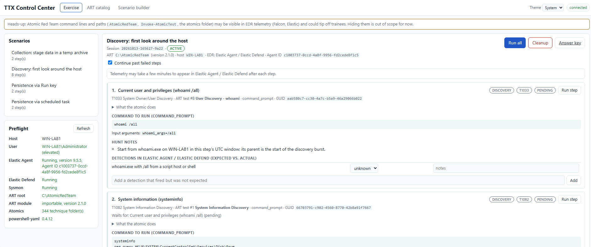
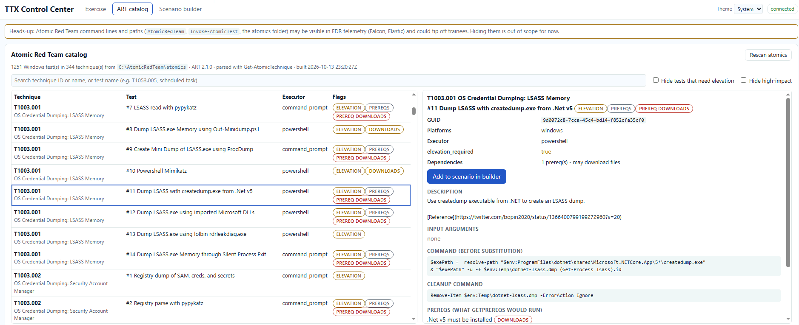
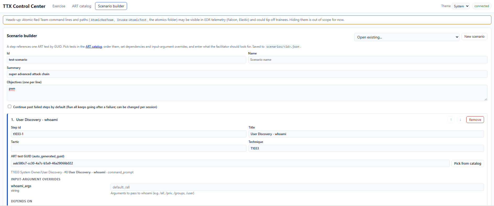

# TTX Control Center

A local web tool for running hands-on EDR hunting exercises on a Windows lab
host. Each scenario step runs an **Atomic Red Team (ART)** test installed on
the host. Trainees hunt the telemetry in their EDR (CrowdStrike Falcon,
Elastic); the facilitator uses this tool to run steps, see exactly what ran,
record which detections fired, and clean up.

This repo is **orchestration only** (D19): no atomics or attack code. A step
references an ART test by GUID plus input arguments.

Tested on a Windows Server lab host with Windows PowerShell 5.1 and
Invoke-AtomicRedTeam 2.1.0.

## Screenshots

| Exercise | ART catalog | Scenario builder |
|---|---|---|
| [](docs/images/exercise.png) | [](docs/images/catalog.png) | [](docs/images/builder.png) |

Taken on the lab host (Windows Server, Elastic Agent 9.5.5, ART 2.1.0).

## Requirements

- Windows PowerShell 5.1 and a browser.
- ART in `C:\AtomicRedTeam` (`invoke-atomicredteam\` and `atomics\`), or
  pass `-ArtRoot <path>` / set `TTX_ART_ROOT`.
- `Install-Module powershell-yaml -Scope CurrentUser` (ART needs it).
- An elevated console for tests marked `elevation_required` and to read EDR
  agent IDs.

## Start

```powershell
powershell.exe -NoProfile -ExecutionPolicy Bypass -File .\Start-ControlCenter.ps1
```

Opens <http://localhost:8080/>; Ctrl+C stops it. Options: `-ArtRoot`,
`-Port`, `-NoBrowser`, `-StepTimeoutSeconds` (default 120),
`-TelemetryDelayMinutes` (default 5, for the ready-to-hunt estimate).

The first start builds the ART catalog in the background (a minute or two);
it's cached in `runs\catalog.json`. When upgrading to a new copy, copy
`runs\` (sessions and catalog) and any scenarios you made in `scenarios\`.

## Using it

- **Preflight**: host, user, elevation, ART status, and EDR/telemetry agents
  found by Windows service: CrowdStrike Falcon (with AID), Elastic Agent
  (with agent ID), Elastic Defend, Sysmon (D22).
- **ART catalog**: browse and search the installed Windows tests (GUID,
  executor, elevation, inputs, prereqs, commands).
- **Scenario builder**: pick tests, order them, set dependencies, input
  overrides, verify checks, expected detections and hunt notes; saves
  `scenarios\<id>.json`. Format: [docs/scenario-format.md](docs/scenario-format.md).
- **Exercise**: load a scenario, **Run step** or **Run all**. Each step checks
  prereqs, runs the test, records the command, UTC window, exit code and
  output, then runs verify checks.
  - Missing prereqs pause the step; GetPrereqs runs only after you confirm
    (and confirm again if it downloads).
  - Dependencies are enforced. **Continue past failed steps** lets Run all
    keep going after a failure (D20).
  - Mark which expected detections fired in each step's checklist.
  - **Answer key** (`runs\<id>\answer-key.md`): host, agents, per-step
    command, window, verify results, hunt notes, starter searches (Kibana
    KQL, Falcon Event Search, Sysmon) and checklist results.
- **Stop** kills the running step and every process it started (also on
  timeout and Ctrl+C); queued steps are dropped and Cleanup still covers it.
- **Cleanup** runs ART `-Cleanup` for every step that ran, in reverse order,
  from saved state (works after a restart), then re-checks verify.

Guardrails: elevated tests are blocked unless the console is elevated;
destructive techniques (T1485, T1486, T1489, T1490, T1529, T1561) need the
ID typed to be added. ART paths and command lines are visible in EDR
telemetry and may tip off trainees.

## Built-in scenarios

Ready to load. No elevation, no downloads, ART cleanup for anything left
behind; Continue past failed steps is on.

| Scenario | Chain | Left until Cleanup |
|---|---|---|
| Discovery: first look around the host | whoami → systeminfo → network config → tasklist → local accounts → local groups → netstat → net view | Nothing |
| Persistence via scheduled task | Encoded PowerShell → `schtasks /create` task `spawn` (runs once at 06:00) | Task `\spawn` |
| Persistence via Run key | cmd writes `%TEMP%\test.bin` → HKCU Run value → `notepad.exe` | File, Run value |
| Collection: stage data in a temp archive | whoami → `Compress-Archive` of ART's sample folder to `%TEMP%` | Zip |

If a GUID isn't in your ART version, the step warns; re-pick it in the
builder.

## Testing

```powershell
powershell.exe -NoProfile -ExecutionPolicy Bypass -File .\tests\Test-Syntax.ps1
powershell.exe -NoProfile -ExecutionPolicy Bypass -File .\tests\Invoke-SmokeTest.ps1
```

The smoke test uses a mock `Invoke-AtomicTest` and a fake technique in
`tests\fixtures\art` (echo and marker files only), so nothing real runs.
Expect `Smoke test passed.`

On the lab host: load a built-in scenario, **Run all**, check the verify
results and the artifact by hand (e.g. `Get-ScheduledTask -TaskName spawn`),
find the activity in your EDR with the answer key's starter searches,
restart the control center, then **Cleanup** and confirm the artifact is
gone. Files fetched by GetPrereqs (usually `C:\AtomicRedTeam\ExternalPayloads`)
are not removed by cleanup.

## Troubleshooting

- **Port in use**: `-Port 8090`.
- **Scripts disabled**: use `-ExecutionPolicy Bypass` as above.
- **Catalog unavailable / ART not importable**: check Preflight paths and
  that powershell-yaml is installed.
- **"requires elevation"**: restart from an elevated console or pick another
  test.
- **Step failed**: open **ART output** on the step; the EDR or antivirus may
  have blocked it, or the tool may not work on this Windows build.
- **Step stuck in RUNNING**: press **Stop**. Commands get no input, so a
  prompt (e.g. "task already exists, replace?") fails instead of waiting;
  check the step's ART output and clean up leftovers (e.g.
  `schtasks /delete /tn spawn /f`).
- **Can't load a scenario**: read "Not ready to load" under it (e.g. a
  `<placeholder>` left in a verify check).

## Layout

```
Start-ControlCenter.ps1   entry point
server/                   engine, HTTP API, ART runner, catalog builder, verify, preflight
ui/                       web UI (plain HTML/CSS/JS)
scenarios/                scenarios (<id>.json)
modules/                  stub modules for engine tests only
tests/                    syntax check, smoke test, mock ART fixtures
runs/                     sessions, logs, catalog cache (gitignored)
docs/                     brief, decisions, scenario format, API, stub contract
```

More: [API](docs/api.md) · [decisions](docs/decisions.md) ·
[changelog](CHANGELOG.md)
